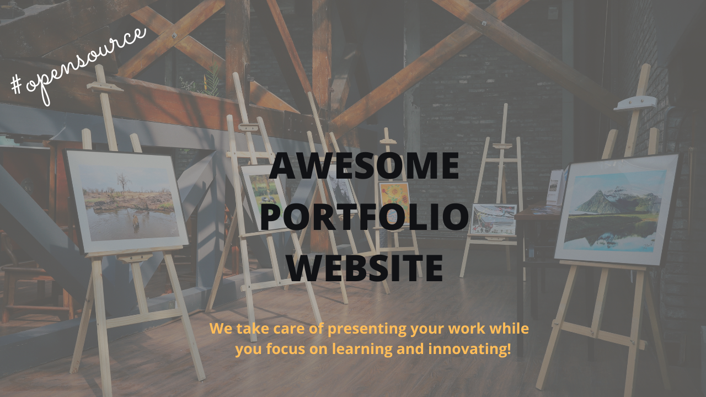
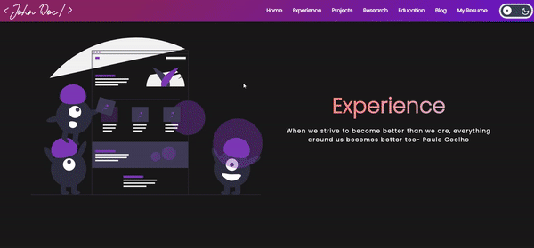
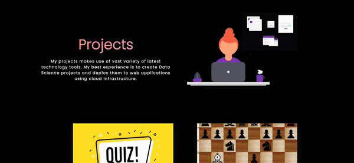
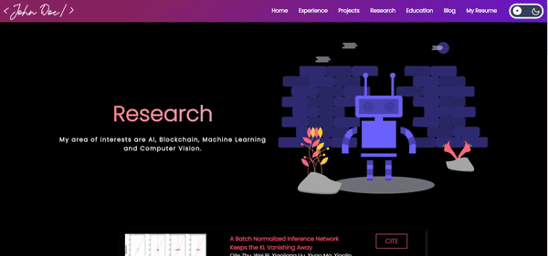
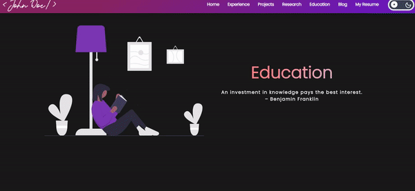
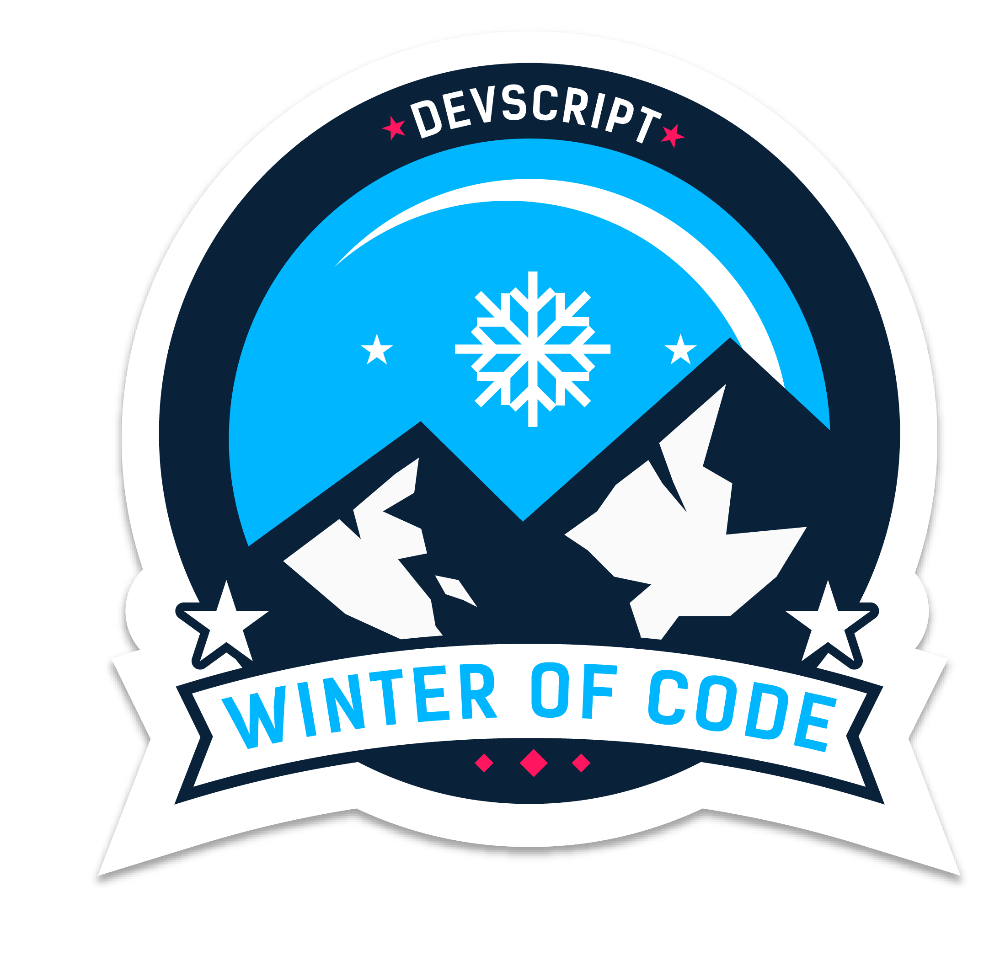
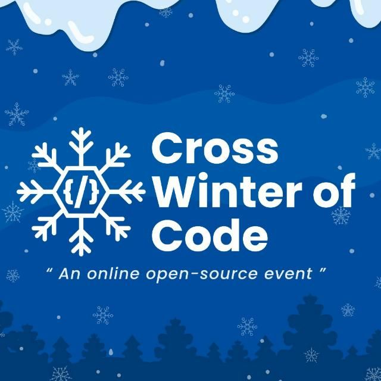
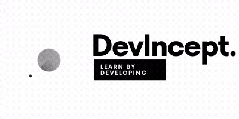
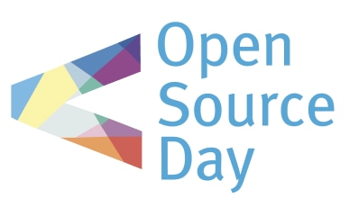

A community maintained open source project aimed at making personal portfolio for researchers, developers and analysts simple, fast and less cumbersome. We make sure you have a full-fledged website to showcase your work while you can spend time on your learning and innovative endeavours.

## A sneak peek into what we have here🙈 :

### Home Page:

### Experience Page:

### Project Page:

### Research Page:

### Education Page:

## How to use this?🛠

[Check out our awesome Documentation](https://smaranjitghose.github.io/awesome-portfolio-websites/)

## Contribution Guidelines🏗

Are we missing any of your favorite features, which you think you can add to it❓ We invite you to contribute to this project and improve it further.

Click on the image below to set up and contribute to the project or [Click here](https://github.com/smaranjitghose/awesome-portfolio-websites/blob/master/CONTRIBUTING.md)

## Project Maintainers👨🏫:

|  |  | 
| :----------------------------------------------------------: | :----------------------------------------------------------: | 
|     [Smaranjit Ghose](https://github.com/smaranjitghose) |    [Anush Bhatia](https://github.com/anushbhatia)                       

## Our valuable Contributors👩‍💻👨‍💻 :

## Open Source Programs we have been a part of:

## 🌐 Web Resources & Interactive Index
- [MAFIA ROULETTE](https://studyplayings.web.app/mafia-roulette.html)
- [CATEGORY STRATEGY](https://studyquesthub.web.app/category-strategy.html)
- [BLOCK PUZZLE FROZEN JEWEL](https://esskillcrafts.pages.dev/block-puzzle-frozen-jewel.html)
- [CLICKER HEROES](https://quizverses.pages.dev/clicker-heroes.html)
- [TOUCHDOWN MASTER](https://themindplays.pages.dev/touchdown-master.html)
- [FOX ADVENTURE](https://thequizzone.pages.dev/fox-adventure.html)
- [CATEGORY INTERSTELLARNETWORK](https://thequizzone.pages.dev/category-interstellarnetwork.html)
- [CATEGORY CASUAL 5](https://themindplaying.web.app/category-casual-5.html)
- [ALIEN INTELLIGENCE TEST](https://quizverses.pages.dev/alien-intelligence-test.html)
- [HUNT AND SEEK](https://themindplay.pages.dev/hunt-and-seek.html)
- [HIDDEN OBJECT EMILYS CASE](https://themindplays.pages.dev/hidden-object-emilys-case.html)
- [ANIMAL BLOCKS](https://thelearnquesters.pages.dev/animal-blocks.html)
- [CATEGORY GROW GAMES](https://thelearnquester.web.app/category-grow-games.html)
- [GRANNY PILLS DEFEND CACTUSES](https://studyplaying.github.io/granny-pills-defend-cactuses.html)
- [DESERT ROVER SURVIVAL](https://themindplay.pages.dev/desert-rover-survival.html)
- [HIDDEN PAIRS MAHJONG](https://studyquests.pages.dev/hidden-pairs-mahjong.html)
- [ELLIE S RECIPE DUBAI CHOCOLATE BAR](https://quizverses.pages.dev/ellie-s-recipe-dubai-chocolate-bar.html)
- [BACKGAMMON DELUXE EDITION](https://themindplaying.web.app/backgammon-deluxe-edition.html)
- [MISTER MINE](https://themindplaying.web.app/mister-mine.html)
- [TAP GALLERY](https://themindplay.pages.dev/tap-gallery.html)
- [FOOD TRUCK CHEF COOKING](https://studyplaying.github.io/food-truck-chef-cooking.html)
- [JETSTREAM ESCAPE](https://themindplay.pages.dev/jetstream-escape.html)
- [SWORD LIFE](https://skillplay.github.io/sword-life.html)
- [CATEGORY UNBLOCKED WEBSITES](https://quizverses.pages.dev/category-unblocked-websites.html)
- [BANK ROBBERY ESCAPE](https://theskillquest.pages.dev/bank-robbery-escape.html)
- [EASTER SHADOW MATCH](https://themindplays.pages.dev/easter-shadow-match.html)
- [NEKOS ADVENTURE](https://thequizzone.pages.dev/nekos-adventure.html)
- [CATEGORY BUBBLE SHOOTER](https://themindplay.github.io/category-bubble-shooter.html)
- [THATS MY SEAT LOGIC PUZZLE](https://studyquests.github.io/thats-my-seat-logic-puzzle.html)
- [GRIDDLERS DELUXE](https://themindplay.github.io/griddlers-deluxe.html)
- [GTA GRAND VEGAS CRIME](https://iskillquest.pages.dev/gta-grand-vegas-crime.html)
- [TRUCKTOPOLIS COOKING CHAOS](https://themindplay.pages.dev/trucktopolis-cooking-chaos.html)
- [TENNIS MASTERS 2026](https://iskillquest.pages.dev/tennis-masters-2026.html)
- [CATEGORY PUZZLE](https://studyquests.github.io/category-puzzle.html)
- [REAL CAR PARKING AND STUNT](https://studyplaying.github.io/real-car-parking-and-stunt.html)
- [FRUIT BLOCK TETRA PUZZLE](https://thelearnquesters.pages.dev/fruit-block-tetra-puzzle.html)
- [CATEGORY 3D1 371](https://learnquester.github.io/category-3d1-371.html)
- [PORTAL MASTER](https://themindplaying.web.app/portal-master.html)
- [MATH KING MATH SKILL GAME](https://iskillquest.pages.dev/math-king-math-skill-game.html)
- [TIMEWARRIORS](https://studyplaying.github.io/timewarriors.html)
- [THE OFFICE ESCAPE](https://quizverses.pages.dev/the-office-escape.html)
- [SOLITAIRE KLONDIKE TREASURE ISLAND](https://quizverses.pages.dev/solitaire-klondike-treasure-island.html)
- [THE SORTING MART](https://studyquests.github.io/the-sorting-mart.html)
- [PEOPLE PLAYGROUND RAGDOLL ARENA](https://studyplaying.github.io/people-playground-ragdoll-arena.html)
- [CATEGORY CAT55](https://studyplayings.web.app/category-cat55.html)
- [BRAINSTORMING 2D](https://thelearnquesters.pages.dev/brainstorming-2d.html)
- [CATEGORY SHOP](https://studyplayings.web.app/category-shop.html)
- [ASMR BEAUTY HOMELESS](https://themindplaying.web.app/asmr-beauty-homeless.html)
- [CATEGORY LISTS](https://studyplayings.pages.dev/category-lists.html)
- [CAR VS ZOMBIES](https://studyquests.github.io/car-vs-zombies.html)
- [DREAM RESTAURANT 3D](https://iskillquest.pages.dev/dream-restaurant-3d.html)
- [BALL SORT COLOR PUZZLE](https://iskillquest.pages.dev/ball-sort-color-puzzle.html)
- [HAPPY MONSTERS 2](https://themindplays.pages.dev/happy-monsters-2.html)
- [CATEGORY THINKY 2](https://studyplayings.web.app/category-thinky-2.html)
- [CATEGORY PUZZLE 4](https://skillplay.github.io/category-puzzle-4.html)
- [CLICKER KNIGHTS VS DRAGONS](https://thelearnquesters.pages.dev/clicker-knights-vs-dragons.html)
- [SNIPER 3D ZOMBIE](https://studyplayings.web.app/sniper-3d-zombie.html)
- [CATEGORY TOP DOWN251](https://thequizzone.pages.dev/category-top-down251.html)
- [MAHJONG CONNECT TILES](https://themindplay.pages.dev/mahjong-connect-tiles.html)
- [CATEGORY PENALTY](https://theskillquest.pages.dev/category-penalty.html)
- [HAPPY BROTHERS](https://thelearnquesters.pages.dev/happy-brothers.html)
- [MERGE SQUARES](https://thelearnquesters.pages.dev/merge-squares.html)
- [FISH SORT](https://iskillquest.pages.dev/fish-sort.html)
- [BASKET SWAP](https://studyquests.github.io/basket-swap.html)
- [HEXA ARROWS PUZZLE](https://quizverses.pages.dev/hexa-arrows-puzzle.html)
- [CATEGORY CASUAL 8](https://studyquests.pages.dev/category-casual-8.html)
- [TWO SUPRA DRIFTERS](https://quizverses.pages.dev/two-supra-drifters.html)
- [MERGE CUBE CHALLENGE](https://quizverses.pages.dev/merge-cube-challenge.html)
- [REAL MOTORBIKE SUPER HERO STUNT 3D](https://studyplayings.web.app/real-motorbike-super-hero-stunt-3d.html)
- [GOLD MINER TOWER DEFENSE](https://thequizzone.pages.dev/gold-miner-tower-defense.html)
- [SKINFLUENCER BEAUTY ROUTINE](https://iskillquest.pages.dev/skinfluencer-beauty-routine.html)
- [SLOPE EMOJI 2](https://quizverses.pages.dev/slope-emoji-2.html)
- [BATTLE ARENA](https://studyquests.github.io/battle-arena.html)
- [FLOWBALL](https://quizverses-9d2f2.web.app/flowball.html)
- [MUSKETEERS GUNPOWDER VS STEEL](https://thequizzone.pages.dev/musketeers-gunpowder-vs-steel.html)
- [SUPER TANK WRESTLE](https://quizverses.pages.dev/super-tank-wrestle.html)
- [MERGE MASTER](https://thequizzone.pages.dev/merge-master.html)
- [IDLE TOWN BILLIONAIRE](https://thelearnquesters.pages.dev/idle-town-billionaire.html)
- [CATEGORY JUMPING147](https://learnquester.github.io/category-jumping147.html)
- [ITALIAN BRAINROT BABY CLICKER](https://themindplaying.web.app/italian-brainrot-baby-clicker.html)
- [MERGE TOWN](https://quizverses-9d2f2.web.app/merge-town.html)
- [JEWEL COLORING](https://themindplays.pages.dev/jewel-coloring.html)
- [CAPYBARA GO](https://themindplaying.web.app/capybara-go.html)
- [UNLOCK THE BOLTS](https://learnquester.github.io/unlock-the-bolts.html)
- [BURGER EMPIRE](https://iskillquest.pages.dev/burger-empire.html)
- [CRAFT MAN VS GIANT TNT](https://iskillquest.pages.dev/craft-man-vs-giant-tnt.html)
- [CUPHEAD](https://thelearnquesters.pages.dev/cuphead.html)
- [CONNECT CLUES THE MISSING PROFESSOR](https://themindplaying.web.app/connect-clues-the-missing-professor.html)
- [CRAZY BUS STATION](https://thequizzone.pages.dev/crazy-bus-station.html)
- [CATEGORY SPACE](https://quizverses.pages.dev/category-space.html)
- [TARCAT](https://themindplaying.web.app/tarcat.html)
- [CATEGORY FPS](https://studyplaying.github.io/category-fps.html)
- [WOODY TAP BLOCK](https://skillplay.github.io/woody-tap-block.html)
- [CATEGORY TURN BASED30](https://quizverses.pages.dev/category-turn-based30.html)
- [CATEGORY SCHOOL](https://studyquests.github.io/category-school.html)
- [CUBE TO HOLE PUZZLE](https://studyplayings.web.app/cube-to-hole-puzzle.html)
- [WATER SORT COLLECTIONS](https://themindzone.pages.dev/water-sort-collections.html)
- [CATEGORY CASUAL 3](https://learnquester.github.io/category-casual-3.html)
- [LABUBU MERGE CLICKER](https://iskillquest.pages.dev/labubu-merge-clicker.html)
- [SQUID GAME HUNTER](https://quizverses.pages.dev/squid-game-hunter.html)
- [MAJESTIC DRAGONS MERGE](https://themindzone.pages.dev/majestic-dragons-merge.html)
- [IDLE ARCHER TOWER DEFENSE RPG](https://themindzone.pages.dev/idle-archer-tower-defense-rpg.html)
- [ARROW CUBE ESCAPE](https://quizverses-9d2f2.web.app/arrow-cube-escape.html)
- [CATEGORY UNBLOCKED WEBSITE](https://quizverses.pages.dev/category-unblocked-website.html)
- [NUMBER COLLECTOR BRAINTEASER](https://themindplay.pages.dev/number-collector-brainteaser.html)
- [CATEGORY DRESS UP](https://studyplayings.pages.dev/category-dress-up.html)
- [PUZZLES BALLS MERGE THE NEW YEAR](https://thequizzone.pages.dev/puzzles-balls-merge-the-new-year.html)
- [ANGRY CHIBI RUN](https://thelearnquesters.pages.dev/angry-chibi-run.html)
- [ZOMBIE SHOOTING KING](https://studyquests.github.io/zombie-shooting-king.html)
- [GEOMETRY VIBES X BALL](https://studyplayings.web.app/geometry-vibes-x-ball.html)
- [CATEGORY BASKETBALL](https://learnquester.github.io/category-basketball.html)
- [PARKOUR BLOCK OBBY](https://studyquests.github.io/parkour-block-obby.html)
- [ZOMBIE EEASTER BUNNIES](https://iskillquest.pages.dev/zombie-eeaster-bunnies.html)
- [CATEGORY PUZZLE 2](https://studyquests.github.io/category-puzzle-2.html)
- [SLINGER BLOCK](https://theskillquest.pages.dev/slinger-block.html)
- [CLASH OF STONE](https://iskillquest.pages.dev/clash-of-stone.html)
- [THE FLOWERS MERGE AND SELL BOUQUETS](https://quizverses.pages.dev/the-flowers-merge-and-sell-bouquets.html)
- [ANIMAL BASKETBALL](https://iskillquest.pages.dev/animal-basketball.html)
- [CATEGORY ADVENTURE](https://theskillquest.pages.dev/category-adventure.html)
- [IDLE TRADE ROUTES](https://studyplayings.pages.dev/idle-trade-routes.html)
- [BARBIECORE AESTHETICS](https://theskillquest.pages.dev/barbiecore-aesthetics.html)
- [TAP 3D BLOCKS](https://theskillquest.pages.dev/tap-3d-blocks.html)
- [COLOR BLOCK JAM](https://iskillquest.pages.dev/color-block-jam.html)
- [CATEGORY SHOP49](https://studyplayings.web.app/category-shop49.html)
- [UNBLOCK IT 3D](https://studyplayings.web.app/unblock-it-3d.html)
- [CATEGORY SPORTS](https://studyplayings.web.app/category-sports.html)
- [DELTA FORCE AIRBORNE](https://studyplayings.web.app/delta-force-airborne.html)
- [HIGH HEELS COLLECT RUN](https://learnquester.github.io/high-heels-collect-run.html)
- [CAR COLLISION MASTER](https://studyplaying.github.io/car-collision-master.html)
- [CATEGORY OBSTACLE299](https://quizverses-9d2f2.web.app/category-obstacle299.html)
